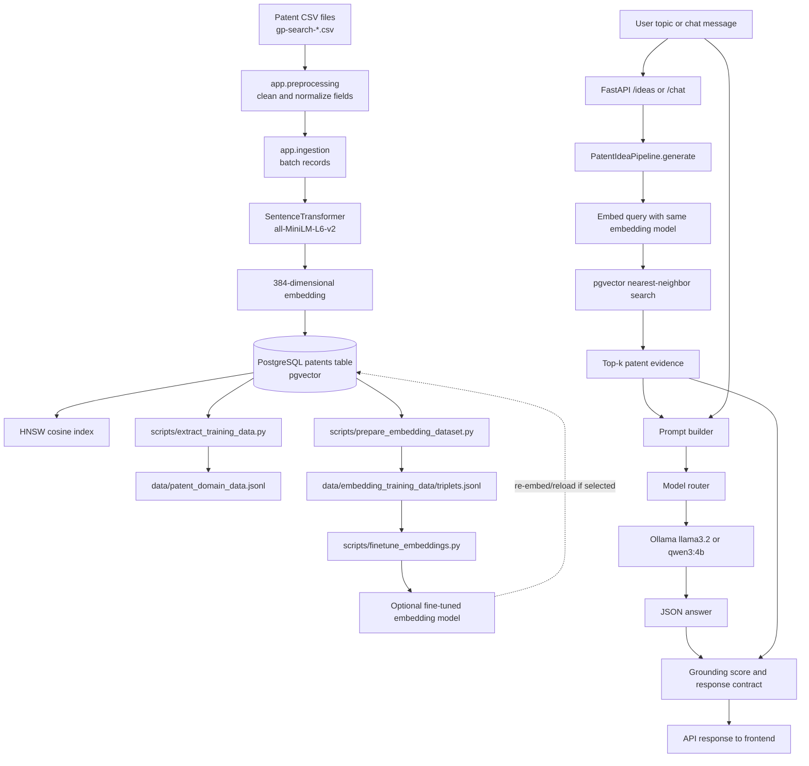

# Invenza patent backend: complete explanation

This document explains what the backend does from the original CSV files to the
final answer returned by the API.

## Important terminology: “triples” versus “triplets”

This project does **not** currently build an RDF triple store or a graph
database. It uses **ML training triplets**:

```text
(anchor patent, positive patent, hard-negative patent)
```

The words look similar, but they mean different things:

| Term | Meaning | Used here? |
|---|---|---|
| RDF triple | `(subject, predicate, object)`, for example `(patent A, cites, patent B)` | No |
| ML triplet | `(anchor, positive, negative)` used to train an embedding model | Yes |
| Vector embedding | A 384-number representation of patent text | Yes |
| Vector database/index | PostgreSQL plus `pgvector` and an HNSW index | Yes |

Therefore, the 84k/87k patents are not converted into semantic graph edges.
They are stored as patent records and vectors. A separate script creates
training examples from their nearest-neighbor vectors.

## One-page architecture graph



The dashed arrow is optional. The checked-in application normally uses the
configured embedding model in `.env`; generating a fine-tuned model does not
automatically switch the running application to it.

## 1. Configuration and startup

File: [`app/config.py`](C:/Users/hp/OneDrive/Desktop/Invenza/Backend/app/config.py)

1. `load_dotenv(...)` loads values from `Backend/.env`.
2. `Settings` reads:
   - `DATABASE_URL`: PostgreSQL connection string.
   - `EMBEDDING_MODEL`: defaults to
     `sentence-transformers/all-MiniLM-L6-v2`.
   - `CSV_DIR`: directory containing `gp-search-*.csv`.
   - `BATCH_SIZE`: ingestion batch size, default `128`.
   - `OLLAMA_BASE_URL`: where the Ollama HTTP server is running.
   - `OLLAMA_MODEL`: default generation model, normally `llama3.2`.
   - `QWEN_OLLAMA_MODEL`: alternate model, normally `qwen3:4b`.
   - `DEFAULT_TOPIC`: CLI default topic.
3. `metric_target_min` and `metric_target_max` define the display/quality
   target range of 75–80. They do not force the model to produce a score in
   that range.
4. `settings = Settings()` creates one immutable configuration object imported
   by the other modules.

The API application is created in [`app/api.py`](C:/Users/hp/OneDrive/Desktop/Invenza/Backend/app/api.py):

1. `FastAPI(...)` creates the HTTP application.
2. CORS is enabled for all origins, methods, and headers so the frontend can
   call the API.
3. Pydantic models validate request and response shapes:
   - `IdeaRequest` accepts a non-empty topic and `top_k` from 1 to 12.
   - `ChatRequest` accepts a topic plus prior conversation messages.
   - `IdeaResponse` and `ChatResponse` describe what the frontend receives.

## 2. How the patent CSV becomes a database row

Main file: [`app/ingestion.py`](C:/Users/hp/OneDrive/Desktop/Invenza/Backend/app/ingestion.py)

### Reading and normalizing a CSV

`read_csv_rows(csv_path)`:

1. `pd.read_csv(..., skiprows=1, dtype=str, keep_default_na=False)` skips the
   first search URL row, keeps values as strings, and avoids pandas converting
   empty values into floating-point `NaN`.
2. Column names are stripped and lower-cased.
3. Each pandas row is converted to a Python dictionary and yielded lazily.
   Lazy iteration prevents all CSVs from needing to be held in memory at once.

`iter_patent_records(csv_path)`:

1. Reads each normalized row.
2. Skips empty rows.
3. Calls `as_patent_record(row, csv_path.name)`.
4. Invalid rows (currently rows missing an ID) raise `ValueError` and are
   skipped.
5. Converts the dataclass back into a dictionary containing the database
   fields.

The conversion happens in
[`app/preprocessing.py`](C:/Users/hp/OneDrive/Desktop/Invenza/Backend/app/preprocessing.py):

- `clean_text` trims whitespace, converts blank/`nan` values to `None`, and
  collapses repeated whitespace.
- `normalize_cpc_ipc` uppercases classification codes, changes separators into
  spaces, removes unsupported punctuation, and returns a list.
- `as_patent_record` maps alternative CSV column names such as `id` or
  `patent_id`, and `inventor/author` or `inventors`.
- `build_embedding_text` creates one labeled text document containing title,
  abstract, claims, assignee, inventors, dates, CPC codes, and IPC codes.

Example embedding text:

```text
Title: ...
Abstract: ...
Claims: ...
Assignee: ...
Inventors: ...
Filing date: ...
Publication date: ...
CPC codes: ...
IPC codes: ...
```

Labels matter because the embedding model sees the field meaning as well as
the field value.

### Batching

`load_csv_files` finds files matching `gp-search-*.csv`.

`batch_records(items, size)` accumulates records until `size` is reached,
yields that list, and finally yields a smaller final batch. With the default
batch size, the model processes up to 128 patent texts at a time.

### Database schema and vector creation

`TABLE_SQL` creates `patents` if it does not exist. Important columns are:

- `source_file` and `patent_id`: the logical key.
- patent metadata such as `title`, `abstract`, `claims`, dates, classifications,
  links, and citations.
- `embedding_text`: the exact labeled text embedded by the model.
- `embedding vector(384)`: the numeric vector stored by `pgvector`.

The primary key is `(source_file, patent_id)`. This means the same patent ID
can exist in different source files without colliding.

`INDEX_SQL` creates an HNSW index using `vector_cosine_ops`. This makes nearest
neighbor search practical without comparing the query against every vector in
Python.

`ingest_patents` then:

1. Loads `SentenceTransformer(model_name)`.
2. Checks that the model produces exactly 384 dimensions. This protects the
   database column from receiving a vector with the wrong shape.
3. Connects with `psycopg`.
4. Enables the PostgreSQL `vector` extension.
5. Registers pgvector's Python adapter.
6. Creates the table and HNSW index if needed.
7. For every batch, extracts `embedding_text`.
8. Calls `model.encode(texts, normalize_embeddings=True, ...)`.
   Normalization makes cosine similarity behave consistently and gives the
   search distance a useful scale.
9. Zips each original row with its corresponding embedding. `strict=True`
   detects an unexpected mismatch instead of silently dropping data.
10. `executemany(UPSERT_SQL, values)` writes all rows in the batch.
11. `ON CONFLICT ... DO UPDATE` makes ingestion repeatable: existing rows are
    updated rather than duplicated.
12. `connection.commit()` makes that batch durable.

The older top-level [`ingest_patents.py`](C:/Users/hp/OneDrive/Desktop/Invenza/Backend/ingest_patents.py)
is a simpler version of this loader. It has fewer columns and should not be
confused with the richer `app/ingestion.py` pipeline.

## 3. What happened to the approximately 84k patents?

The checked-in training metadata reports:

```json
{
  "total_patents": 87497,
  "total_triplets": 262491,
  "hard_negative_count": 3,
  "triplets_per_anchor": 3.0
}
```

So “84k” is a rounded description. The generated dataset records **87,497
patents**. The exact number in the database can differ if CSVs were changed,
rows were invalid, or ingestion was run against a different database.

The patent records are used in three separate ways:

1. **Search corpus:** each patent's embedding is stored in PostgreSQL and
   queried for semantic similarity.
2. **Domain data export:** `extract_training_data.py` writes one JSON object per
   patent to `data/patent_domain_data.jsonl`.
3. **Embedding fine-tuning data:** `prepare_embedding_dataset.py` derives
   triplets from existing embeddings.

The API does not send all 87,497 patents to the LLM. For one request it sends
only the top `top_k` results, normally 3 and never more than 12.

## 4. How the ML triplets are generated

File: [`scripts/prepare_embedding_dataset.py`](C:/Users/hp/OneDrive/Desktop/Invenza/Backend/scripts/prepare_embedding_dataset.py)

The script first selects `source_file`, `patent_id`, `title`,
`embedding_text`, and `embedding` from the database. It uses the already
stored vectors, so it does not need to encode all patents again.

For every anchor patent:

1. `neighbor_sql` excludes the anchor itself.
2. `ORDER BY embedding <=> %s` sorts by pgvector cosine distance.
3. `LIMIT hard_negative_count + 1` requests four neighbors by default:
   one pseudo-positive plus three negatives.
4. `positive = neighbor_rows[0]` selects the closest other patent as the
   **pseudo-positive**.
5. `negatives = neighbor_rows[1:hard_negative_count + 1]` selects the next
   three nearest patents as **hard negatives**.
6. For each negative, the script writes one JSON line:

```json
{
  "anchor": "text of anchor patent",
  "positive": "text of nearest patent",
  "negative": "text of next-nearest patent",
  "anchor_id": "...",
  "positive_id": "...",
  "negative_id": "..."
}
```

With 87,497 anchors and three negatives per anchor:

```text
87,497 anchors × 3 negatives = 262,491 triplets
```

That is why the triplet count is about three times the patent count. It does
**not** mean that each patent was copied into three database rows. The triplets
are training records in a separate JSONL file.

### Why “hard negatives”?

A random unrelated patent is too easy: the model can distinguish it without
learning much. A hard negative is close in the current embedding space but is
treated as a different example. Triplet loss then tries to make:

```text
distance(anchor, positive) < distance(anchor, negative)
```

The current implementation calls the nearest neighbor a pseudo-positive. That
is an approximation based on embedding similarity, not a human-confirmed
business or legal relationship. The positive/negative labels can therefore
contain noise.

## 5. What the triplets are used for

File: [`scripts/finetune_embeddings.py`](C:/Users/hp/OneDrive/Desktop/Invenza/Backend/scripts/finetune_embeddings.py)

1. `load_triplets_dataset` reads JSONL one line at a time.
2. Each line becomes `InputExample(texts=[anchor, positive, negative])`.
3. A shuffled `DataLoader` creates mini-batches.
4. `losses.TripletLoss(model=model)` defines the learning objective.
5. `model.fit(...)` updates the base
   `sentence-transformers/all-MiniLM-L6-v2` model for the configured epochs.
6. `model.save(output_dir)` writes the fine-tuned embedding model.
7. `finetuning_config.json` records the base model and training settings.

This improves the geometry of the embedding space if the pseudo-labels are
useful. It does not directly teach the LLM to answer questions and it does
not create new patent facts.

The saved model only affects the production search pipeline after it is
explicitly selected in configuration and the database has been re-embedded
with the same model. Mixing old database vectors with a new query model is
incorrect because the vectors would live in different spaces.

## 6. How a user request is searched

Relevant file: [`app/retrieval.py`](C:/Users/hp/OneDrive/Desktop/Invenza/Backend/app/retrieval.py)

`search_patents(query, limit)`:

1. Loads the configured sentence-transformer.
2. Encodes the user's query into a normalized 384-dimensional vector.
3. Connects to PostgreSQL and registers pgvector.
4. Checks which optional columns exist. This compatibility logic lets the
   search work with the older table schema as well.
5. Executes a query that returns metadata plus:
   - `1 - (embedding <=> query_vector)` as cosine similarity.
   - `embedding <-> query_vector` as L2 distance.
6. `ORDER BY embedding <=> query_vector` puts the closest patents first.
7. `LIMIT` restricts the evidence set.
8. Converts database rows to dictionaries for the pipeline.

The query is semantic, not a literal keyword search. For example, a query
about crop sensing can retrieve a patent whose title uses different words but
whose embedded text is near the query in vector space.

## 7. How the answer is generated

Entry points in [`app/api.py`](C:/Users/hp/OneDrive/Desktop/Invenza/Backend/app/api.py):

### `POST /ideas`

1. FastAPI validates `IdeaRequest`.
2. `PatentIdeaPipeline()` creates the retrieval, scoring, routing, and LLM
   components.
3. `pipeline.generate(request.topic, top_k=request.top_k)` runs the complete
   pipeline.
4. `IdeaResponse(**result)` validates and serializes the JSON response.

### `POST /chat`

1. Validates the topic, prior messages, and `top_k`.
2. Converts Pydantic messages to dictionaries.
3. Ensures the latest user message is present.
4. Calls the same `pipeline.generate`, but passes conversation history.
5. Creates an assistant message from the generated summary.
6. Adds up to three used patent references and links.
7. Returns the answer plus normalized conversation and evidence.

### `PatentIdeaPipeline.generate`

File: [`app/pipeline.py`](C:/Users/hp/OneDrive/Desktop/Invenza/Backend/app/pipeline.py)

1. Starts a timer for total latency.
2. Calculates synthetic `FALLBACK-01` IDs in case the database is unavailable.
3. Calls `search_patents(topic, limit=top_k)`.
4. If search succeeds, maps each result into prompt evidence.
5. If search fails or returns no rows, creates local fallback evidence. This is
   not real patent evidence; it is an availability fallback.
6. If no model is forced, asks the router which model to use.
7. Calls `build_idea_prompt`.
8. Calls the selected LLM with `temperature=0.3` and `max_tokens=600`.
9. If that model fails, calls the other model as a fallback.
10. If both models fail, returns a JSON error-shaped research-assistant
    response.
11. Parses the model response as JSON.
12. If the response is not JSON, keeps the raw text as a short summary.
13. If the summary is empty, creates a deterministic template-based answer
    using the retrieved patent IDs.
14. Calculates grounding features.
15. Returns the concept, answer, evidence, sources, scores, model name, and
    timing.

## 8. The prompt sent to the language model

File: [`app/llm.py`](C:/Users/hp/OneDrive/Desktop/Invenza/Backend/app/llm.py),
`build_idea_prompt`

For every retrieved patent, the prompt includes:

- patent ID,
- title,
- assignee,
- abstract (or fallback text),
- CPC and IPC codes.

For chat requests it includes only the last eight conversation messages.
The instructions tell the model to:

1. answer the latest message;
2. answer follow-ups directly;
3. distinguish recommendations from patent-backed facts;
4. use only supplied patent evidence;
5. name the strongest patent IDs;
6. return JSON with `concept_name`, `summary`, and `evidence`.

The LLM therefore receives a small retrieved context, not the entire corpus.
This is a retrieval-augmented generation (RAG) pattern:

```text
user question -> vector retrieval -> evidence prompt -> language model answer
```

## 9. Which model runs, and why answers differ

File: [`app/model_router.py`](C:/Users/hp/OneDrive/Desktop/Invenza/Backend/app/model_router.py)

The router estimates complexity from word count:

1. `word_count = len(query.split())`.
2. `estimated_tokens = word_count * 1.3`.
3. Short/simple requests route to `qwen3:4b`.
4. Longer/complex requests route to `llama3.2`.
5. If the chosen model fails, `get_fallback_model` switches to the other one.

File: [`app/llm.py`](C:/Users/hp/OneDrive/Desktop/Invenza/Backend/app/llm.py)

For Ollama:

1. A POST is sent to `/api/generate`.
2. `stream: false` requests one complete response.
3. `temperature: 0.3` controls sampling variation.
4. `num_predict` caps the output length.

For local Qwen:

1. The prompt is tokenized.
2. The model generates up to `max_new_tokens`.
3. `do_sample=True` enables sampling.
4. `temperature=0.3` and `top_p=0.9` shape token selection.

Answers can differ between requests because:

- sampling is enabled (`do_sample=True` locally; Ollama receives temperature);
- temperature is non-zero;
- the model may have multiple plausible next tokens;
- a different model may be selected by the router;
- retrieved rankings can change if the database or embeddings change;
- chat history changes the prompt;
- fallback model selection changes the generation path.

The code does not set a random seed, so exact repeatability is not promised.
Even with a fixed seed, model/runtime differences can still affect output.
The answer should therefore be treated as a generated synthesis grounded by
retrieved evidence, not as a fixed database lookup.

## 10. How grounding and the score are calculated

File: [`app/grounding.py`](C:/Users/hp/OneDrive/Desktop/Invenza/Backend/app/grounding.py)

The score formula is:

```text
score =
    0.45 * retrieval_similarity
  + 0.25 * citation_overlap
  + 0.20 * topic_alignment
  + 0.10 * text_consistency
```

The result is multiplied by 100 and receives a small rank penalty. In the
current pipeline the rank is always set to 1, so that penalty is zero.

The four components mean:

- `retrieval_similarity`: average cosine similarity of the returned patents.
- `citation_overlap`: fraction of retrieved patent IDs literally appearing in
  the generated text.
- `topic_alignment`: fraction of normalized topic tokens appearing in the
  generated text.
- `text_consistency`: average of retrieval similarity and topic alignment.

This is a heuristic quality indicator. It is not a legal validity score,
novelty opinion, patentability determination, or human evaluation.

The `75–80` target is checked by `passes_target`; the generation code does not
rewrite the answer to reach the target.

## 11. The exact response shape

The API normally returns:

```json
{
  "concept_name": "...",
  "summary": "...",
  "source_patents": ["..."],
  "used_patent_ids": ["..."],
  "grounding_score": 78.12,
  "passes_target": true,
  "evidence_summary": "...",
  "retrieval_details": {
    "retrieval_similarity": 82.0,
    "citation_overlap": 66.67,
    "topic_alignment": 75.0,
    "text_consistency": 78.5
  },
  "model_used": "llama3.2",
  "inference_time_ms": 1234.56,
  "total_latency_ms": 1500.12,
  "evidence": [
    {
      "patent_id": "...",
      "title": "...",
      "cosine_similarity": 0.82
    }
  ]
}
```

`source_patents` contains all retrieved IDs. `used_patent_ids` is the first
three unique IDs used as the primary references. `/chat` exposes only up to
three reference evidence records in the assistant message.

## 12. What is and is not a graph in the current UI

`GET /patent-cluster` in [`app/api.py`](C:/Users/hp/OneDrive/Desktop/Invenza/Backend/app/api.py)
reads `data/patent_domain_data.jsonl`, groups records into four filename-based
domains, and returns positioned nodes and cluster counts.

That endpoint is a visualization layout, not a learned relationship graph:

- domains are inferred from source filenames;
- node positions are calculated with fixed centers and offsets;
- no RDF predicates are created;
- no patent-to-patent edges are returned;
- the endpoint samples records up to the requested limit.

The vector index is the actual similarity structure used for retrieval. If the
project later needs a true knowledge graph, it would need an explicit schema
such as `(patent, hasAssignee, company)` and `(patentA, cites, patentB)`, plus a
graph store or RDF serialization. That is not present in the current backend.

## 13. Practical end-to-end summary

```text
CSV row
  -> cleaned PatentRecord
  -> labeled embedding text
  -> 384-number vector
  -> PostgreSQL patents row + HNSW index

Existing vectors
  -> nearest-neighbor mining
  -> one pseudo-positive + three hard negatives per anchor
  -> 262,491 JSONL training triplets
  -> optional TripletLoss fine-tuning

User question
  -> query vector
  -> top-k nearest patents
  -> prompt containing those patents
  -> routed LLM with sampling
  -> JSON answer
  -> heuristic grounding score
  -> FastAPI response
```

The most important conceptual point is that the patent corpus is used for
**retrieval and embedding training**, while the language model is responsible
for **wording the final response**. The LLM does not read all patents on every
request; it sees only the evidence selected by vector search.

